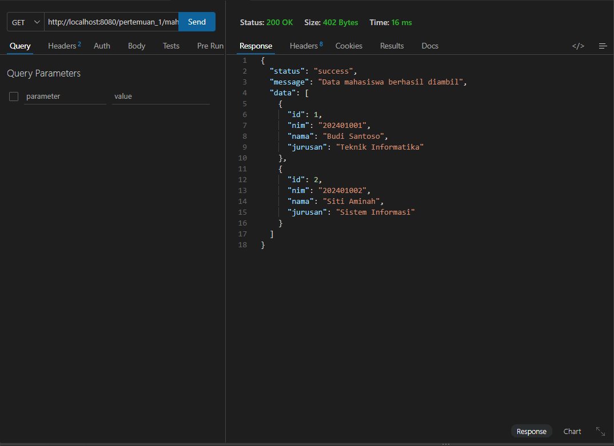
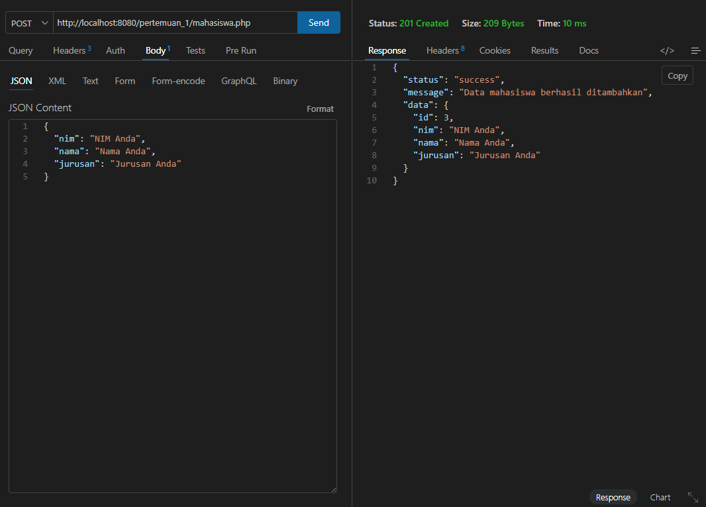

# PDCS Pertemuan 1 — Git & REST API

Tugas individu Pertemuan 1 mata kuliah **Pemrograman Client-Server**.

REST API sederhana untuk data mahasiswa, ditulis dengan PHP, dan diuji dengan **Thunder Client** di VS Code.

## Isi repository

| File | Keterangan |
|---|---|
| `mahasiswa.php` | Endpoint REST API (GET & POST) |
| `data.json` | Penyimpanan data mahasiswa (pengganti tabel database) |
| `start-server.bat` | Menjalankan server PHP di `localhost:8080` |
| `screenshots/` | Screenshot hasil testing di Thunder Client |

## Endpoint

| Method | URL | Fungsi | Status sukses |
|---|---|---|---|
| GET | `http://localhost:8080/pertemuan_1/mahasiswa.php` | Ambil semua data mahasiswa | `200 OK` |
| GET | `http://localhost:8080/pertemuan_1/mahasiswa.php?id=1` | Ambil satu data mahasiswa | `200 OK` |
| POST | `http://localhost:8080/pertemuan_1/mahasiswa.php` | Tambah data mahasiswa baru | `201 Created` |

Kalau memakai Laragon, salin folder ini ke `C:\laragon\www\pertemuan_1` dan pakai URL `http://localhost/pertemuan_1/mahasiswa.php`.

## Cara menjalankan

1. Jalankan `start-server.bat` (atau dari folder induk: `php -S localhost:8080 -t .`).
2. Buka Thunder Client di VS Code, lalu klik **New Request**.

### Testing GET

1. Pilih method **GET**.
2. Isi URL `http://localhost:8080/pertemuan_1/mahasiswa.php`.
3. Klik **Send**. Hasilnya `Status: 200 OK`.

### Testing POST

1. Ganti method ke **POST**.
2. Di tab **Headers**, tambahkan `Content-Type: application/json`.
3. Di tab **Body** → **JSON**, isi:

   ```json
   {
     "nim": "nim-kamu",
     "nama": "nama-kamu",
     "jurusan": "jurusan-kamu"
   }
   ```

4. Klik **Send**. Hasilnya `Status: 201 Created`.

## Contoh response

GET:

```json
{
  "status": "success",
  "message": "Data mahasiswa berhasil diambil",
  "data": [
    { "id": 1, "nim": "202401001", "nama": "Budi Santoso", "jurusan": "Teknik Informatika" },
    { "id": 2, "nim": "202401002", "nama": "Siti Aminah", "jurusan": "Sistem Informasi" }
  ]
}
```

POST:

```json
{
  "status": "success",
  "message": "Data mahasiswa berhasil ditambahkan",
  "data": { "id": 3, "nim": "nim-kamu", "nama": "nama-kamu", "jurusan": "jurusan-kamu" }
}
```

## Hasil testing Thunder Client

### GET



### POST


